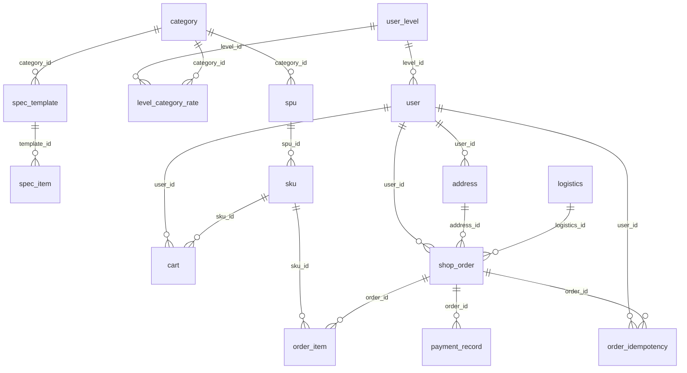

# 五金商城系统数据库设计文档

**文档版本**：V3.1
**最后更新**：2026-11-26
**项目名称**：乾程锁具生意通（微信小程序 + Web 管理端）
**数据库类型**：MySQL 8.0
**结构事实源**：`db/migration/V1__baseline.sql`

---

## 一、文档概述

### 1.1 编写目的

描述当前数据库的实体关系、表结构、索引与业务规则，作为后端开发、评审与问题排查的参考。

### 1.2 技术选型

- **数据库**：MySQL 8.0，字符集 `utf8mb4`，排序规则 `utf8mb4_general_ci`
- **ORM**：MyBatis-Plus（实体位于 `entity/db/`，与表一一对应）
- **结构变更**：Flyway 版本化迁移，只允许新增 `db/migration/V*.sql`

### 1.3 模型概览

- **SPU + SKU + 规格模板**：SPU 保存商品公共信息，SKU 保存具体规格组合、批发基价与库存；规格由分类级模板/规格项定义。
- **多级定价**：`user_level` 定义用户等级，`level_category_rate` 保存「等级 × 分类」倍率矩阵；`sku.price` 是批发基价，成交单价 = 批发基价 × 倍率，下单时把等级与倍率快照写入 `order_item`。
- **下单幂等**：`order_idempotency` 以数据库唯一键 `(user_id, idem_key)` 与状态机为唯一权威，Redis 不参与下单幂等。

### 1.4 事实源与维护约定

1. 表结构唯一事实源是 `db/migration/V1__baseline.sql`。本文档的字段清单已于 **2026-11-24** 与之逐表对齐。
2. 已发布的迁移文件不得修改。新增结构变更时，必须新增 `V2__...sql` 并同步更新本文档。
3. 字段类型、可空性、默认值以 baseline 为准；字段注释中与代码口径不一致的已知项集中记录在 [5.8](#58-已知注释与代码口径差异)。
4. 真实商品数据（价格表导入）不纳入版本控制，通过运维脚本单独导入。

---

## 二、实体关系设计

### 2.1 实体关系图



### 2.2 关系说明

- **user_level ↔ user / level_category_rate**：一个等级可被多个用户使用，并配置多个分类倍率；零售等级固定存在，不可改名、停用或删除。
- **category ↔ spu / spec_template / level_category_rate**：分类下挂商品、规格模板与各等级倍率。
- **spu ↔ sku**：一个 SPU 包含多个 SKU；SKU 的规格组合由 `spec_hash` 保证同 SPU 内唯一。
- **spec_template ↔ spec_item**：分类级规格模板包含多个可选值；删除模板级联删除规格项。
- **user ↔ address / cart / shop_order / order_idempotency**：用户维度的一对多关系。
- **shop_order ↔ order_item**：订单包含多个明细；明细保存商品、规格、价格与等级快照。
- **shop_order ↔ payment_record**：一个订单可有多条支付/退款流水，`out_trade_no` 全局唯一。
- **shop_order ↔ order_idempotency**：创建成功的订单可关联一条幂等记录（`order_id`）。

---

## 三、表结构设计

> 共 15 张表。以下字段清单从 `db/migration/V1__baseline.sql` 生成，与实体类字段一一对应。

### `user_level` — 用户等级表

| 字段 | 类型 | 允许空 | 默认值 | 说明 |
|------|------|:---:|--------|------|
| `id` | BIGINT UNSIGNED | 否 | — | 等级ID |
| `name` | VARCHAR(50) | 否 | — | 等级名称，如：零售/批发A/批发B |
| `is_retail` | TINYINT | 否 | 0 | 是否零售等级：1-是（倍率固定1.0，不可改名/删除），0-否 |
| `sort_order` | INT | 否 | 0 | 排序权重，数值越大越靠前 |
| `status` | TINYINT | 否 | 1 | 等级状态：1-启用，0-停用 |
| `create_time` | DATETIME | 否 | CURRENT_TIMESTAMP | 创建时间 |
| `update_time` | DATETIME | 否 | CURRENT_TIMESTAMP | 更新时间 |

**键与索引**：PRIMARY KEY(`id`)；`uk_name`(`name`)；`idx_status_sort`(`status`, `sort_order` DESC)

### `user` — 用户表

| 字段 | 类型 | 允许空 | 默认值 | 说明 |
|------|------|:---:|--------|------|
| `id` | BIGINT UNSIGNED | 否 | — | 用户ID |
| `openid` | VARCHAR(64) | 否 | — | 微信OpenID |
| `unionid` | VARCHAR(64) | 是 | NULL | 微信UnionID |
| `nickname` | VARCHAR(50) | 是 | NULL | 用户昵称 |
| `avatar_url` | VARCHAR(255) | 是 | NULL | 用户头像URL |
| `phone` | VARCHAR(20) | 是 | NULL | 用户手机号 |
| `province` | VARCHAR(50) | 是 | NULL | 用户所在省份 |
| `city` | VARCHAR(50) | 是 | NULL | 用户所在城市 |
| `role` | TINYINT | 否 | 1 | 用户角色：1-普通用户，2-管理员 |
| `level_id` | BIGINT UNSIGNED | 否 | 1 | 用户等级ID |
| `status` | TINYINT | 否 | 1 | 用户状态：1-正常，0-禁用 |
| `last_login_time` | DATETIME | 是 | NULL | 最后登录时间 |
| `last_login_ip` | VARCHAR(50) | 是 | NULL | 最后登录IP地址 |
| `create_time` | DATETIME | 否 | CURRENT_TIMESTAMP | 创建时间 |
| `update_time` | DATETIME | 否 | CURRENT_TIMESTAMP | 更新时间 |
| `delete_time` | BIGINT | 是 | 0 | 删除时间，软删除标识 |

**键与索引**：PRIMARY KEY(`id`)；`uk_openid`(`openid`)；`uk_phone`(`phone`)；`idx_level_id`(`level_id`)；`idx_status`(`status`)；`idx_create_time`(`create_time`)；`fk_user_level` FOREIGN KEY (`level_id`) → `user_level`(`id`)

### `address` — 收货地址表

| 字段 | 类型 | 允许空 | 默认值 | 说明 |
|------|------|:---:|--------|------|
| `id` | BIGINT UNSIGNED | 否 | — | 地址ID |
| `user_id` | BIGINT UNSIGNED | 否 | — | 用户ID |
| `consignee` | VARCHAR(50) | 否 | — | 收货人姓名 |
| `phone` | VARCHAR(20) | 否 | — | 收货人手机号 |
| `province` | VARCHAR(50) | 否 | — | 省份 |
| `city` | VARCHAR(50) | 否 | — | 城市 |
| `district` | VARCHAR(50) | 否 | — | 区县 |
| `detail` | VARCHAR(255) | 否 | — | 详细地址 |
| `postal_code` | VARCHAR(10) | 是 | NULL | 邮政编码 |
| `is_default` | TINYINT | 否 | 0 | 是否默认地址：1-默认，0-非默认 |
| `create_time` | DATETIME | 否 | CURRENT_TIMESTAMP | 创建时间 |
| `update_time` | DATETIME | 否 | CURRENT_TIMESTAMP | 更新时间 |
| `delete_time` | BIGINT | 是 | 0 | 删除时间，软删除标识 |

**键与索引**：PRIMARY KEY(`id`)；`idx_user_id`(`user_id`)；`idx_user_default`(`user_id`, `is_default`)；`fk_address_user` FOREIGN KEY (`user_id`) → `user`(`id`) ON DELETE CASCADE

### `category` — 商品分类表

| 字段 | 类型 | 允许空 | 默认值 | 说明 |
|------|------|:---:|--------|------|
| `id` | BIGINT UNSIGNED | 否 | — | 分类ID |
| `parent_id` | BIGINT UNSIGNED | 否 | 0 | 父级分类ID，0表示顶级分类 |
| `name` | VARCHAR(50) | 否 | — | 分类名称 |
| `icon` | VARCHAR(255) | 是 | NULL | 分类图标URL或emoji |
| `sort_order` | INT | 否 | 0 | 排序权重，数值越大越靠前 |
| `status` | TINYINT | 否 | 1 | 分类状态：1-启用，0-禁用 |
| `create_time` | DATETIME | 否 | CURRENT_TIMESTAMP | 创建时间 |
| `update_time` | DATETIME | 否 | CURRENT_TIMESTAMP | 更新时间 |
| `delete_time` | BIGINT | 是 | 0 | 删除时间，软删除标识 |

**键与索引**：PRIMARY KEY(`id`)；`idx_parent_id`(`parent_id`)；`idx_status_sort`(`status`, `sort_order` DESC)

### `level_category_rate` — 等级分类倍率表

| 字段 | 类型 | 允许空 | 默认值 | 说明 |
|------|------|:---:|--------|------|
| `id` | BIGINT UNSIGNED | 否 | — | 主键 |
| `level_id` | BIGINT UNSIGNED | 否 | — | 用户等级ID |
| `category_id` | BIGINT UNSIGNED | 否 | — | 商品分类ID |
| `rate` | DECIMAL(6,4) | 否 | — | 倍率(0,1]，成交价=零售价×rate |
| `create_time` | DATETIME | 否 | CURRENT_TIMESTAMP | 创建时间 |
| `update_time` | DATETIME | 否 | CURRENT_TIMESTAMP | 更新时间 |

**键与索引**：PRIMARY KEY(`id`)；`uk_level_category`(`level_id`, `category_id`)；`idx_category_id`(`category_id`)；`fk_lcr_level` FOREIGN KEY (`level_id`) → `user_level`(`id`)；`fk_lcr_category` FOREIGN KEY (`category_id`) → `category`(`id`)

### `spu` — 商品型号表(SPU)

| 字段 | 类型 | 允许空 | 默认值 | 说明 |
|------|------|:---:|--------|------|
| `id` | BIGINT UNSIGNED | 否 | — | 商品型号ID |
| `category_id` | BIGINT UNSIGNED | 否 | — | 分类ID |
| `name` | VARCHAR(100) | 否 | — | 商品名称(SPU) |
| `subtitle` | VARCHAR(200) | 是 | NULL | 商品副标题 |
| `description` | TEXT | 是 | NULL | 商品详细描述，支持富文本 |
| `images` | JSON | 是 | NULL | 商品图片列表，JSON数组格式 |
| `original_price` | DECIMAL(10,2) | 是 | NULL | 商品原价 |
| `weight` | DECIMAL(10,2) | 是 | NULL | 商品重量，单位：千克 |
| `sales_count` | INT | 否 | 0 | 商品销量 |
| `status` | TINYINT | 否 | 1 | 商品状态：1-上架，0-下架 |
| `is_recommend` | TINYINT | 否 | 0 | 是否推荐商品：1-推荐，0-非推荐 |
| `exclude_discount` | TINYINT | 否 | 0 | 不参与折扣：1-是，0-否 |
| `create_time` | DATETIME | 否 | CURRENT_TIMESTAMP | 创建时间 |
| `update_time` | DATETIME | 否 | CURRENT_TIMESTAMP | 更新时间 |
| `delete_time` | BIGINT | 是 | 0 | 删除时间，软删除标识 |

**键与索引**：PRIMARY KEY(`id`)；`idx_category_id`(`category_id`)；`idx_status`(`status`)；`idx_status_recommend`(`status`, `is_recommend`)；`idx_status_sales`(`status`, `sales_count` DESC)；`idx_name`(`name`)；`ft_name`(`name`)；`fk_spu_category` FOREIGN KEY (`category_id`) → `category`(`id`)

### `sku` — 商品SKU表

| 字段 | 类型 | 允许空 | 默认值 | 说明 |
|------|------|:---:|--------|------|
| `id` | BIGINT UNSIGNED | 否 | — | SKU ID |
| `spu_id` | BIGINT UNSIGNED | 否 | — | SPU ID |
| `specs` | JSON | 否 | — | 规格组合 [{"templateId":1,"itemId":1,"name":"颜色","value":"金色"},...] |
| `price` | DECIMAL(10,2) | 否 | 0 | SKU价格 |
| `stock` | INT | 否 | 0 | SKU库存数量 |
| `image` | VARCHAR(255) | 是 | NULL | SKU图片 |
| `status` | TINYINT | 否 | 1 | SKU状态：1-启用，0-禁用 |
| `spec_hash` | VARCHAR(64) | 否 | — | 规格组合哈希值，用于快速查找 |
| `create_time` | DATETIME | 否 | CURRENT_TIMESTAMP | 创建时间 |
| `update_time` | DATETIME | 否 | CURRENT_TIMESTAMP | 更新时间 |
| `delete_time` | BIGINT | 是 | 0 | 删除时间，软删除标识 |

**键与索引**：PRIMARY KEY(`id`)；`uk_spu_specs`(`spu_id`, `spec_hash`)；`idx_spu_id`(`spu_id`)；`idx_status`(`status`)；`idx_stock`(`stock`)；`fk_sku_spu` FOREIGN KEY (`spu_id`) → `spu`(`id`) ON DELETE CASCADE

### `spec_template` — 规格模板表

| 字段 | 类型 | 允许空 | 默认值 | 说明 |
|------|------|:---:|--------|------|
| `id` | BIGINT UNSIGNED | 否 | — | 规格模板ID |
| `category_id` | BIGINT UNSIGNED | 否 | — | 分类ID |
| `name` | VARCHAR(50) | 否 | — | 规格名称(如:颜色/尺寸/锁体大小) |
| `spec_type` | TINYINT | 否 | 1 | 规格类型:1-选择型,2-输入型 |
| `is_required` | TINYINT | 否 | 1 | 是否必选:1-必选,0-可选 |
| `sort_order` | INT | 否 | 0 | 排序权重 |
| `create_time` | DATETIME | 否 | CURRENT_TIMESTAMP | 创建时间 |
| `update_time` | DATETIME | 否 | CURRENT_TIMESTAMP | 更新时间 |
| `delete_time` | BIGINT | 是 | 0 | 删除时间，软删除标识 |

**键与索引**：PRIMARY KEY(`id`)；`idx_category_id`(`category_id`)；`idx_category_sort`(`category_id`, `sort_order`)；`fk_spec_template_category` FOREIGN KEY (`category_id`) → `category`(`id`) ON DELETE CASCADE

### `spec_item` — 规格项表

| 字段 | 类型 | 允许空 | 默认值 | 说明 |
|------|------|:---:|--------|------|
| `id` | BIGINT UNSIGNED | 否 | — | 规格项ID |
| `template_id` | BIGINT UNSIGNED | 否 | — | 所属模板ID |
| `value` | VARCHAR(50) | 否 | — | 规格值(如:白色/50mm/金色) |
| `sort_order` | INT | 否 | 0 | 排序权重 |
| `create_time` | DATETIME | 否 | CURRENT_TIMESTAMP | 创建时间 |
| `update_time` | DATETIME | 否 | CURRENT_TIMESTAMP | 更新时间 |
| `delete_time` | BIGINT | 是 | 0 | 删除时间，软删除标识 |

**键与索引**：PRIMARY KEY(`id`)；`idx_template_id`(`template_id`)；`idx_template_sort`(`template_id`, `sort_order`)；`fk_spec_item_template` FOREIGN KEY (`template_id`) → `spec_template`(`id`) ON DELETE CASCADE

### `cart` — 购物车表

| 字段 | 类型 | 允许空 | 默认值 | 说明 |
|------|------|:---:|--------|------|
| `id` | BIGINT UNSIGNED | 否 | — | 购物车ID |
| `user_id` | BIGINT UNSIGNED | 否 | — | 用户ID |
| `sku_id` | BIGINT UNSIGNED | 否 | — | SKU ID |
| `quantity` | INT UNSIGNED | 否 | 1 | 购买数量 |
| `create_time` | DATETIME | 否 | CURRENT_TIMESTAMP | 创建时间 |
| `update_time` | DATETIME | 否 | CURRENT_TIMESTAMP | 更新时间 |
| `delete_time` | BIGINT | 是 | 0 | 删除时间，软删除标识 |

**键与索引**：PRIMARY KEY(`id`)；`uk_user_sku`(`user_id`, `sku_id`)；`idx_user_id`(`user_id`)；`idx_sku_id`(`sku_id`)；`fk_cart_user` FOREIGN KEY (`user_id`) → `user`(`id`) ON DELETE CASCADE；`fk_cart_sku` FOREIGN KEY (`sku_id`) → `sku`(`id`) ON DELETE CASCADE

### `logistics` — 物流方式表

| 字段 | 类型 | 允许空 | 默认值 | 说明 |
|------|------|:---:|--------|------|
| `id` | BIGINT UNSIGNED | 否 | — | 物流ID |
| `name` | VARCHAR(50) | 否 | — | 物流名称 |
| `code` | VARCHAR(50) | 否 | — | 物流编码 |
| `description` | VARCHAR(255) | 是 | NULL | 物流描述/备注 |
| `contact` | VARCHAR(50) | 是 | NULL | 物流联系人 |
| `phones` | JSON | 是 | NULL | 物流联系电话列表 |
| `city` | VARCHAR(50) | 是 | NULL | 物流所在城市 |
| `address` | VARCHAR(255) | 是 | NULL | 物流网点地址 |
| `sort_order` | INT | 否 | 0 | 排序权重 |
| `status` | TINYINT | 否 | 1 | 物流状态：1-启用，0-禁用 |
| `create_time` | DATETIME | 否 | CURRENT_TIMESTAMP | 创建时间 |
| `update_time` | DATETIME | 否 | CURRENT_TIMESTAMP | 更新时间 |
| `delete_time` | BIGINT | 是 | 0 | 删除时间，软删除标识 |

**键与索引**：PRIMARY KEY(`id`)；`uk_code`(`code`)；`idx_status_sort`(`status`, `sort_order` DESC)；`idx_city`(`city`)

### `shop_order` — 订单主表

| 字段 | 类型 | 允许空 | 默认值 | 说明 |
|------|------|:---:|--------|------|
| `id` | BIGINT UNSIGNED | 否 | — | 订单ID |
| `order_no` | VARCHAR(32) | 否 | — | 订单编号 |
| `user_id` | BIGINT UNSIGNED | 否 | — | 用户ID |
| `address_id` | BIGINT UNSIGNED | 否 | — | 收货地址ID |
| `logistics_id` | BIGINT UNSIGNED | 是 | NULL | 物流方式ID(自提为空) |
| `delivery_type` | TINYINT | 是 | NULL | 发货方式：2-同城配送，4-用户自提 |
| `wechat_order_state` | TINYINT | 是 | NULL | 微信订单状态(展示/对账)：1待发货 2已发货 3确认收货 4交易完成 5已退款 6资金待结算 |
| `status` | TINYINT | 否 | 1 | 订单状态：1-待付款，2-待发货，3-已发货，4-已完成，5-已取消，6-退款中，7-已退款 |
| `total_amount` | DECIMAL(10,2) | 否 | 0.00 | 订单总金额 |
| `freight_amount` | DECIMAL(10,2) | 否 | 0.00 | 运费金额 |
| `pay_amount` | DECIMAL(10,2) | 否 | 0.00 | 实付金额 |
| `logistics_no` | VARCHAR(50) | 是 | NULL | 物流单号 |
| `pay_time` | DATETIME | 是 | NULL | 支付时间 |
| `ship_time` | DATETIME | 是 | NULL | 发货时间 |
| `receive_time` | DATETIME | 是 | NULL | 收货时间 |
| `cancel_time` | DATETIME | 是 | NULL | 取消时间 |
| `cancel_reason` | VARCHAR(255) | 是 | NULL | 取消原因 |
| `buyer_remark` | VARCHAR(500) | 是 | NULL | 买家备注 |
| `admin_remark` | VARCHAR(500) | 是 | NULL | 管理员备注 |
| `create_time` | DATETIME | 否 | CURRENT_TIMESTAMP | 创建时间 |
| `update_time` | DATETIME | 否 | CURRENT_TIMESTAMP | 更新时间 |
| `admin_delete_time` | BIGINT | 是 | NULL | 管理员删除时间 |
| `user_delete_time` | BIGINT | 是 | NULL | 用户删除时间 |

**键与索引**：PRIMARY KEY(`id`)；`uk_order_no`(`order_no`)；`idx_user_id`(`user_id`)；`idx_status`(`status`)；`idx_create_time`(`create_time`)；`idx_pay_time`(`pay_time`)；`idx_user_status`(`user_id`, `status`)；`idx_status_create`(`status`, `create_time` DESC)；`fk_order_user` FOREIGN KEY (`user_id`) → `user`(`id`)；`fk_order_address` FOREIGN KEY (`address_id`) → `address`(`id`)；`fk_order_logistics` FOREIGN KEY (`logistics_id`) → `logistics`(`id`)

### `order_item` — 订单明细表

| 字段 | 类型 | 允许空 | 默认值 | 说明 |
|------|------|:---:|--------|------|
| `id` | BIGINT UNSIGNED | 否 | — | 订单明细ID |
| `order_id` | BIGINT UNSIGNED | 否 | — | 订单ID |
| `sku_id` | BIGINT UNSIGNED | 否 | — | SKU ID(下单时快照) |
| `spu_id` | BIGINT UNSIGNED | 否 | — | SPU ID(下单时快照) |
| `product_name` | VARCHAR(100) | 否 | — | 商品名称快照 |
| `product_spec` | VARCHAR(500) | 是 | NULL | 商品规格快照(JSON) |
| `product_image` | VARCHAR(255) | 是 | NULL | 商品图片快照 |
| `price` | DECIMAL(10,2) | 否 | 0.00 | 商品单价快照 |
| `level_id` | BIGINT UNSIGNED | 是 | — | 下单时用户等级ID快照 |
| `level_name` | VARCHAR(50) | 是 | — | 下单时用户等级名称快照 |
| `pricing_rate` | DECIMAL(6,4) | 是 | — | 下单时适用倍率快照 |
| `quantity` | INT UNSIGNED | 否 | 1 | 购买数量 |
| `subtotal` | DECIMAL(10,2) | 否 | 0.00 | 小计金额 |
| `create_time` | DATETIME | 否 | CURRENT_TIMESTAMP | 创建时间 |

**键与索引**：PRIMARY KEY(`id`)；`idx_order_id`(`order_id`)；`idx_sku_id`(`sku_id`)；`fk_order_item_order` FOREIGN KEY (`order_id`) → `shop_order`(`id`) ON DELETE CASCADE；`fk_order_item_sku` FOREIGN KEY (`sku_id`) → `sku`(`id`)

### `payment_record` — 支付记录表

| 字段 | 类型 | 允许空 | 默认值 | 说明 |
|------|------|:---:|--------|------|
| `id` | bigint | 否 | — |  |
| `order_id` | bigint | 否 | — | 订单ID |
| `out_trade_no` | varchar(64) | 否 | — | 商户订单号 |
| `transaction_id` | varchar(64) | 是 | NULL | 微信支付交易号 |
| `amount` | decimal(10,2) | 否 | — | 支付金额(元) |
| `status` | tinyint | 否 | 0 | 0待支付 1已支付 2已关闭 3已退款 4退款中 |
| `pay_time` | datetime | 是 | NULL | 支付完成时间 |
| `refund_amount` | decimal(10,2) | 是 | NULL | 退款金额 |
| `refund_time` | datetime | 是 | NULL | 退款时间 |
| `create_time` | datetime | 是 | CURRENT_TIMESTAMP |  |
| `update_time` | datetime | 是 | CURRENT_TIMESTAMP |  |

**键与索引**：PRIMARY KEY(`id`)；`uk_out_trade_no`(`out_trade_no`)；`idx_order_id`(`order_id`)

### `order_idempotency` — 下单幂等记录表

| 字段 | 类型 | 允许空 | 默认值 | 说明 |
|------|------|:---:|--------|------|
| `id` | BIGINT | 否 | — |  |
| `user_id` | BIGINT | 否 | — | 用户ID |
| `idem_key` | VARCHAR(128) | 否 | — | 客户端幂等键 |
| `request_hash` | CHAR(64) | 否 | — | 请求指纹 SHA-256 |
| `state` | VARCHAR(16) | 否 | — | PROCESSING/SUCCEEDED/FAILED |
| `owner_token` | VARCHAR(64) | 否 | — | 本次请求持有者令牌 |
| `order_id` | BIGINT | 是 | NULL | 成功后关联的订单ID |
| `create_time` | DATETIME | 否 | CURRENT_TIMESTAMP |  |
| `update_time` | DATETIME | 否 | CURRENT_TIMESTAMP |  |

**键与索引**：PRIMARY KEY(`id`)；`uk_user_idem_key`(`user_id`, `idem_key`)；`idx_state_update`(`state`, `update_time`)

---

## 四、索引设计说明

### 4.1 设计原则

1. **唯一约束优先**：业务唯一键（`openid`、`phone`、`order_no`、`out_trade_no`、`spu_id + spec_hash`、`user_id + sku_id`、`level_id + category_id`、`user_id + idem_key`）全部落库，避免应用层假设。
2. **列表查询走复合索引**：`status + sort_order`（等级/分类/物流）、`status + is_recommend`、`status + sales_count`、`status + create_time`（订单列表）。
3. **归属校验走用户维度**：`user_id`、`user_id + status`、`user_id + is_default`。
4. **关联查询走外键列**：`spu_id`、`sku_id`、`order_id`、`category_id`、`template_id`、`level_id`。
5. **幂等补偿扫描**：`order_idempotency.state + update_time` 支撑超时记录清理/补偿。

### 4.2 关键唯一约束

| 表 | 唯一键 | 业务含义 |
|----|--------|----------|
| `user` | `uk_openid`、`uk_phone` | 一个微信用户一条记录；手机号唯一 |
| `user_level` | `uk_name` | 等级名称唯一 |
| `level_category_rate` | `uk_level_category` | 每个等级每个分类只有一条倍率 |
| `sku` | `uk_spu_specs` | 同一 SPU 下规格组合唯一 |
| `cart` | `uk_user_sku` | 同一用户同一 SKU 只有一条购物车记录 |
| `logistics` | `uk_code` | 物流编码唯一 |
| `shop_order` | `uk_order_no` | 订单号唯一 |
| `payment_record` | `uk_out_trade_no` | 商户订单号全局唯一，保证微信侧幂等 |
| `order_idempotency` | `uk_user_idem_key` | 同一用户的同一幂等键只有一条记录 |

---

## 五、业务规则说明

### 5.1 SPU / SKU 规则

1. 一个 SPU 至少有一个 SKU；商品列表按 SPU 维度展示，价格取该 SPU 下 SKU 的区间。
2. 同一 SPU 下 `spec_hash` 必须唯一。
3. SKU 的规格项必须属于该 SPU 分类下配置的规格模板。
4. 删除 SPU 时其 SKU 级联删除；订单明细保存的是快照，不受商品删除影响。
5. 商品图片只保存 URL；删除 SPU/SKU 不删除 OSS 对象，统一交给图片回收流程（见 `docs/adr/0009-image-object-reclamation.md`）。

### 5.2 规格模板规则

1. 规格模板挂在分类下，分为选择型（`spec_type=1`）与输入型（`spec_type=2`）。
2. 必选规格（`is_required=1`）下单前必须选择或填写。
3. 删除模板级联删除规格项；已被 SKU 引用的规格不应删除。

### 5.3 购物车规则

1. 购物车以 SKU 为单位；同一用户同一 SKU 只保留一条记录，重复添加累加数量。
2. 数量范围由业务层校验；商品下架/倍率缺口时保留记录但标记为不可售。
3. 下单成功后按订单内 SKU 删除对应购物车记录。

### 5.4 多级定价规则（核心）

1. **批发基价**：`sku.price` 表达批发基价；SPU 无 SKU 时以 `spu.original_price` 作为回退展示值。系统中不存在「每个等级一份 SKU 价格」。
2. **等级分类倍率**：`level_category_rate.rate` 的取值范围是 `(0, 3.0000]`，由代码常量校验（`UserLevelStatusConstants.MIN_EXCLUSIVE_RATE / MAX_INCLUSIVE_RATE`），不依赖数据库 CHECK。
3. **等级结算价**：`round(sku.price × rate, 2)`，先算单价再乘数量；金额计算只在后端完成。
4. **倍率缺口**：等级在某分类下没有配置倍率时视为「暂不可售」，**不得回落到 `1.0000`**，也不得向用户展示批发基价。零售等级自身的缺口同样不可售。
5. **`exclude_discount`**：商品级开关；开启后所有等级都按零售等级结算价结算，不影响倍率矩阵本身。
6. **订单快照**：下单瞬间把 `level_id`、`level_name`、`pricing_rate` 写入 `order_item`；后续改等级或倍率不改变既有订单金额。
7. **缓存边界**：商品缓存只保存中性批发基价区间与折扣开关，不保存任何等级的最终价格；倍率缓存独立，倍率变更在事务提交后失效定价缓存（ADR-0002 / ADR-0003）。
8. **匿名与缺失等级**：未登录、等级为空或等级已不存在的用户按零售等级取价。

### 5.5 订单规则

1. 创建订单保存商品快照：`sku_id`、`spu_id`、`product_name`、`product_spec`、`product_image`、`price`、等级快照。
2. 订单支持双向软删除：`admin_delete_time` 与 `user_delete_time` 独立记录。
3. 订单状态：`1` 待付款、`2` 待发货、`3` 已发货、`4` 已完成、`5` 已取消、`6` 退款中、`7` 已退款、`8` 退款申请中、`9` 退款失败。状态流转通过 CAS 条件更新收敛并发。
4. 用户取消仅限待付款；申请退款仅限待发货/已发货，进入 `8` 等待管理员审核。
5. 库存扣减与订单创建在同一事务内完成；退款确认成功后才回补库存，避免提前回补导致超卖。

### 5.6 支付与退款规则

1. 支付流水保存在 `payment_record`，`out_trade_no` 全局唯一。
2. 支付状态：`0` 待支付、`1` 已支付、`2` 已关闭、`3` 已退款、`4` 退款中。
3. 退款采用 claim-first：先 CAS 将支付记录置「退款中」再调用微信退款；外呼结果未知时保持「退款中」，由回调与定时对账收敛。
4. 退款确认成功：支付记录置 `3`，订单推进 `6 → 7` 并回补库存；明确失败：支付记录回到 `1`，订单置 `9` 退款失败，等待管理员重试。
5. 订单详情打开待付款订单时由支付模块做去抖的状态同步，同步失败不影响详情返回。

### 5.7 下单幂等规则

1. 客户端通过 `GET /api/user/order/token` 获取幂等键，并在创建订单时通过 `X-Idempotency-Key` 请求头提交。
2. 数据库唯一键 `(user_id, idem_key)` 是并发最终守卫，`order_idempotency` 状态机记录请求指纹、`PROCESSING / SUCCEEDED / FAILED`、持有者令牌与订单 ID。
3. Redis 不参与下单幂等；认领、重试与防重复下单都不依赖 Redis 可用性。
4. 同一幂等键 + 相同请求指纹的重试返回原订单；指纹不同返回 `40902`（幂等键冲突）；处理中返回「订单处理中，请稍后重试」。
5. 订单创建与库存扣减同事务；事务失败由独立事务把幂等记录置 `FAILED`，允许客户端用同一键重试。

### 5.8 已知注释与代码口径差异

以下差异均位于**已发布**的 `V1__baseline.sql` 字段注释中。按「已发布迁移禁止修改」的约定，只能通过后续迁移修正；当前以代码与 ADR 为准：

| 位置 | baseline 注释 | 当前代码/决策 |
|------|---------------|---------------|
| `shop_order.status` | 只列到 `7-已退款` | 实际还有 `8-退款申请中`、`9-退款失败`（`StatusConstants`） |
| `level_category_rate.rate` | `(0,1]` | 实际为 `(0, 3.0000]`（`UserLevelStatusConstants`，ADR-0004） |
| `user_level.is_retail` | 「倍率固定 1.0」 | 零售等级同样走倍率矩阵；`is_retail` 只约束不可改名/停用/删除（ADR-0004） |
| `sku.price` | 「SKU价格」 | 语义为批发基价（ADR-0004） |

### 5.9 图片引用与订单快照

1. 商品、SKU、订单明细都只保存图片 URL，不保存 OSS 对象本身。
2. 订单明细中的 `product_image` 是下单快照；即使原 OSS 对象被回收，订单历史仍以快照字段为准。
3. 图片对象回收以数据库引用为真相源，延迟回收并保留回收站，见 ADR-0009 与 `docs/image-gc-runbook.md`。

---

## 六、初始化与迁移

```bash
# 仅建库
mysql -u root -p < db/bootstrap/00_create_database.sql

# 执行全部迁移（需要 Flyway；本地也可直接执行 V1）
mysql -u root -p hardware_mall < db/migration/V1__baseline.sql
```

- 后续结构变更只新增 `V2__...sql`、`V3__...sql`，不修改已发布迁移。
- 发布迁移与部署解耦，详见 `docs/release-runbook.md` 与 ADR-0007。
- 真实商品数据请通过运维脚本导入，不提交到仓库。

---

**文档状态**：V3.1 · 2026-11-26
**本次更新**：下单幂等统一为数据库唯一键 + 状态机，移除 Redis 短时锁表述并对齐 ADR-0011。
**V3.0 更新**：补齐 `user_level`、`level_category_rate`、`order_idempotency` 三张表；补全等级、折扣开关与订单快照字段；重写多级定价、支付退款、下单幂等规则；字段清单与 `V1__baseline.sql` 对齐并记录已知注释差异。
